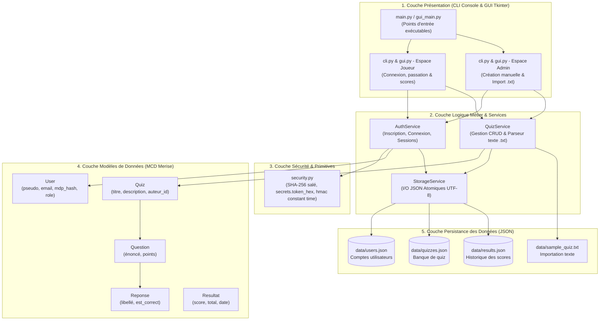

# Architecture Technique & Structure Logicielle - Quizora

> **Version PDF téléchargeable :** [Consulter le document PDF officiel (docs/architecture_technique_quizora.pdf)](architecture_technique_quizora.pdf)

---

## 1. Schéma d'Architecture en Couches (Mermaid)

---

## 2. Synthèse de la Stack Technologique

| Domaine | Outil / Technologie | Rôle dans l'application Quizora |
| :--- | :--- | :--- |
| **Langage & Runtime** | Python 3.10+ | Langage principal imposé, typage avec Type Hinting. |
| **Interface Utilisateur** | Console CLI & Tkinter (GUI) | Deux modes d'exécution natifs : terminal interactif (`cli.py`) et fenêtre graphique moderne (`gui.py`). |
| **Sécurité Cryptographique** | `hashlib`, `secrets`, `hmac` | Hachage SHA-256 salé avec sel cryptographique aléatoire de 16 octets et comparaison à temps constant. |
| **Persistance** | `json` (Bibliothèque standard) | Stockage portable et transparent avec encodage UTF-8 forcé. |
| **Assurance Qualité** | `unittest` | Tests unitaires automatisés d'intégration et de non-régression. |
| **Gestion de Versions** | Git & GitHub | Collaboration à 4 étudiants, revue de code, traçabilité des commits. |
| **Suivi Agile** | Trello (Kanban) | Gestion des User Stories (US01 à US07) et du flux de travail. |
| **Planification** | GanttProject (.gan) | Planification des tâches $\le$ 2 jours avec affectation des ressources. |
| **Modélisation** | Looping (.mdc) | Schéma Entité-Association (MCD Merise). |

---

## 3. Flux d'Interactions Principaux

### A. Inscription et Connexion Sécurisée
1. Saisie des identifiants dans le terminal (`cli.py`).
2. Vérification d'unicité et politique de mot de passe dans `AuthService`.
3. Génération d'un sel cryptographique et calcul du hachage SHA-256 (`security.py`).
4. Écriture atomique dans `data/users.json` via `StorageService`.

### B. Création Manuelle d'un Quiz (Sprint 3 - US04)
1. L'administrateur renseigne le titre et la description.
2. Ajout itératif de questions QCM avec plusieurs choix et indication de la bonne réponse.
3. Sérialisation de l'arborescence (`Quiz` $\rightarrow$ `Question` $\rightarrow$ `Reponse`) dans `data/quizzes.json`.

### C. Importation via Fichier Texte (Sprint 3 - US05)
1. L'administrateur charge un fichier texte structuré (`sample_quiz.txt`).
2. Le parseur extrait les balises `TITRE:`, `QUESTION:`, `*` (bonne réponse), `-` (fausses réponses).
3. Contrôle de validité et intégration automatique dans `data/quizzes.json`.

### D. Passation d'un Quiz par un Joueur (Sprint 3 - US06)
1. Sélection d'un quiz dans le catalogue.
2. Déroulement question par question avec validation des saisies.
3. Calcul en temps réel du score et restitution du corrigé pédagogique.
