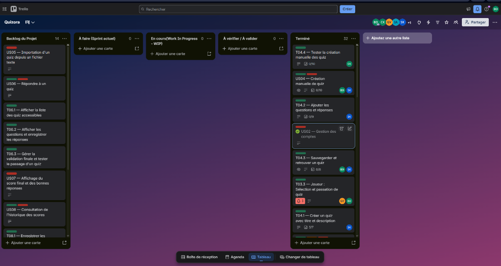

# Compte-Rendu de Séance n°3 - Sprint 3 (Cœur du jeu : Création, Importation & Passation de Quiz)
**Date :** Vendredi 23 Octobre 2026  
**Module :** PROJ531 - Gestion de projet informatique  
**Équipe :** Groupe Quizora (4 membres)  
- **Product Owner :** Bilal Draoui  
- **Développeurs / Collaborateurs :** Sabrine Kawiche, Chadi Kharchoufa, Gabrien Vaz  

**Statut du sprint :** **Sprint 3 - Cœur du jeu (Terminé)**

---

## 1. Objectifs de la Séance n°3 (Sprint 3)
Faisant suite à la validation du Sprint 2 (authentification sécurisée et stockage JSON des utilisateurs), la Séance 3 est dédiée au développement du **cœur fonctionnel de l'application de quiz** :

1. **Administration interactive (US04 / Tâche 3.1) :** Permettre à un administrateur connecté de créer un quiz de bout en bout (titre, description, points, ajout interactif de questions QCM avec sélection de la bonne réponse).
2. **Importation automatisée (US05 / Tâche 3.2) :** Développer un parseur robuste permettant d'importer un quiz complet depuis un fichier texte brut (`.txt`), évitant ainsi la saisie manuelle laborieuse.
3. **Moteur de jeu & Passation (US06 / Tâche 3.3) :** Offrir aux joueurs la possibilité de consulter le catalogue de quiz, d'en sélectionner un, de répondre interactivement aux questions et d'obtenir un décompte immédiat de leurs points.
4. **Assurance qualité :** Étendre la suite de tests unitaires (`tests/`) pour couvrir la sérialisation des quiz, le parseur de fichiers et les calculs de scores.

---

## 2. Répartition des tâches WBS / Gantt de la séance

| Tâche WBS / Gantt | Responsable | Description | Temps estimé | Temps réel | Statut |
| :--- | :--- | :--- | :---: | :---: | :---: |
| **3.1 Admin : Création manuelle de quiz (US04)** | Sabrine Kawiche & Bilal Draoui | Formulaire interactif en console pour créer un quiz, ajouter des questions/réponses et l'enregistrer dans `data/quizzes.json`. | 2h00 | 1h45 | **Terminé** |
| **3.2 Admin : Importation via fichier texte (US05)** | Chadi Kharchoufa | Service de parsing de fichiers `.txt` structurés avec validation syntaxique et conversion en objets `Quiz`. | 2h00 | 1h30 | **Terminé** |
| **3.3 Joueur : Sélection et passation de quiz (US06)** | Gabrien Vaz & Bilal Draoui | Parcours joueur dans le CLI : listing des quiz, affichage séquentiel des questions, saisie contrôlée et calcul du score. | 2h00 | 1h45 | **Terminé** |
| **3.4 Tests unitaires du moteur de quiz** | Gabrien Vaz & Chadi Kharchoufa | Tests automatisés pour la persistance JSON des quiz, le parsing de fichiers valides/invalides et l'évaluation des réponses. | 1h30 | 1h15 | **Terminé** |

---

## 3. Choix techniques & Conception de la séance

1. **Format standardisé du fichier d'importation texte (`.txt`) :**
   - Afin de rendre l'import simple et intuitif pour un enseignant ou administrateur, nous avons retenu une syntaxe claire et lisible :
     ```text
     TITRE: Histoire de l'informatique
     DESCRIPTION: Quiz sur les pionniers de l'informatique et les langages
     
     QUESTION: Qui est considéré comme la première personne à avoir programmé ? [2 pts]
     - Alan Turing
     * Ada Lovelace
     - Grace Hopper
     - Blaise Pascal
     ```
   - Le préfixe `*` marque la bonne réponse, `-` marque les réponses fausses, et `[X pts]` définit les points attribués.
2. **Couplage faible avec `QuizService` :**
   - Création d'un service métier dédié `QuizService` qui centralise les opérations CRUD sur les quiz et sépare la logique de jeu de l'interface en ligne de commande (`cli.py`).
3. **Persistance dans `data/quizzes.json` :**
   - Extension de `StorageService` pour la sauvegarde et le chargement atomique des quiz via les méthodes `to_dict()` et `from_dict()` déjà éprouvées dans `Quiz`, `Question` et `Reponse`.

---

## 4. Suivi de projet & Organisation Kanban (Trello)
- Toutes les cartes relatives au Sprint 3 (**US04** - Création manuelle de quiz, **US05** - Importation via fichier texte, **US06** - Répondre à un quiz, ainsi que leurs sous-tâches associées **T04.1**, **T04.2**, **T04.3**, **T04.4** et **T03.3**) ont été développées, testées et déplacées dans la colonne **Terminé** du tableau Kanban.
- Les critères d'acceptation (*Definition of Done*) pour ce sprint sont pleinement atteints :
  - Création de quiz fonctionnelle manuellement ou par import de fichier texte.
  - Parcours joueur fluide avec vérification des réponses et calcul automatique du score.
  - 100% des tests unitaires validés avec succès sur le dépôt Git.

Ci-dessous, la capture d'écran du tableau Trello attestant de la clôture des tâches du Sprint 3 dans la colonne **Terminé** :



---

## 5. Prochaine séance (Sprint 4 - 02/11/2026) : Finitions, Scores & Soutenance
- Développer la persistance des résultats et l'historique personnel des joueurs (`results.json`, tâche 3.4 / US07).
- Session de "chasse aux bugs" et vérification de la robustesse globale (tâche 4.1).
- Rédaction du rapport final de projet (tâche 4.2).
- Répétition de la démonstration orale pour la soutenance (tâche 4.3).
