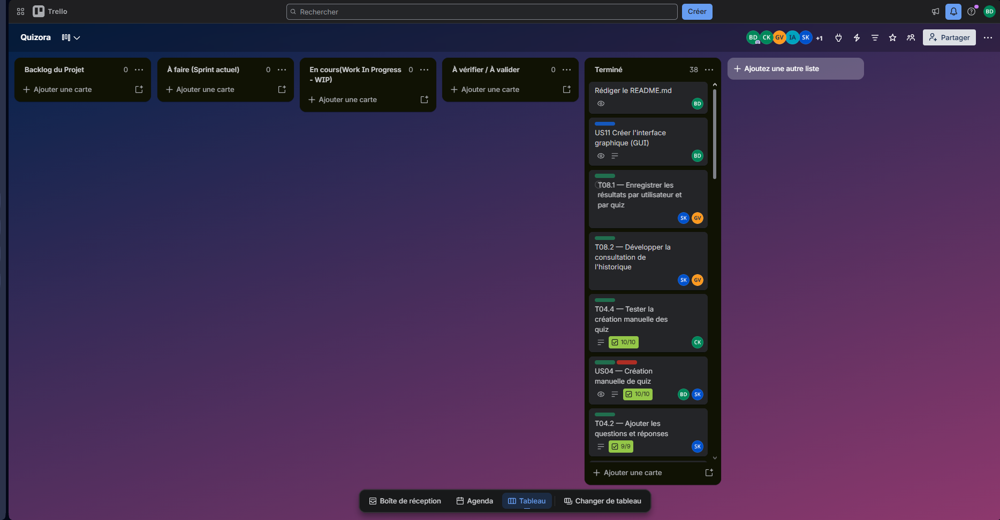

# Compte-Rendu de Séance n°4 - Sprint 4 (Historique des scores, Consolidation & Soutenance)
**Date :** Lundi 02 Novembre 2026  
**Module :** PROJ531 - Gestion de projet informatique  
**Équipe :** Groupe Quizora (4 membres)  
- **Product Owner :** Bilal Draoui  
- **Développeurs / Collaborateurs :** Sabrine Kawiche, Chadi Kharchoufa, Gabrien Vaz  

**Statut du sprint :** **Sprint 4 - Finitions & Soutenance (En cours)**

---

## 1. Objectifs de la Séance n°4 (Sprint 4)
Le Sprint 3 a livré le cœur du jeu (création, import et passation de quiz). Entre-temps, une interface graphique Tkinter (page de connexion et tableau de bord) a été ajoutée et le dossier d'architecture technique a été mis à jour. Le Sprint 4, dernier sprint du projet, a pour objectifs :

1. **Historique des scores (US07 / cartes T08.1 et T08.2) :** Enregistrer chaque passage de quiz dans `data/results.json` et permettre au joueur de consulter son historique personnel.
2. **Chasse aux bugs :** Relire le code livré aux sprints précédents, repérer et corriger les anomalies.
3. **Rapport final :** Rédiger le rapport de fin de projet.
4. **Préparation de la soutenance :** Préparer et répéter la démonstration orale de 15 minutes.

---

## 2. Répartition des tâches WBS / Gantt de la séance

| Tâche Trello | Responsable | Description | Temps estimé | Temps réel | Statut |
| :--- | :--- | :--- | :---: | :---: | :---: |
| **T08.1 - Enregistrer les résultats par utilisateur et par quiz (US07)** | Sabrine Kawiche & Gabrien Vaz | Enregistrement du score dans `data/results.json` à la fin d'un quiz (service `ResultatService`). | 2h00 | *à compléter* | **Terminé** |
| **T08.2 - Développer la consultation de l'historique (US07)** | Sabrine Kawiche & Gabrien Vaz | Affichage de l'historique du joueur dans le menu console, avec moyenne et meilleur score. | 1h30 | *à compléter* | **Terminé** |
| **Tests unitaires de l'historique** | Chadi Kharchoufa | Fichier `tests/test_resultat.py` (5 tests) : persistance, scores incohérents, quiz vide, filtrage et tri par joueur, statistiques. | 1h00 | *à compléter* | **Terminé** |
| **Chasse aux bugs et robustesse** | Chadi Kharchoufa & Bilal Draoui | Relecture de l'ensemble du code, correction des anomalies relevées et nettoyage du code inutilisé (voir section 3.2). | 1h30 | *à compléter* | **Terminé** |
| **Rédaction du rapport final** | Bilal Draoui & Équipe | Synthèse du projet : gestion de projet (WBS, PBS, Gantt, Trello), architecture, bilan des sprints. | 2h00 | *à compléter* | **En cours** |
| **Préparation de la soutenance** | Équipe | Scénario de démonstration (admin puis joueur), support de présentation, répétition chronométrée. | 1h30 | *à compléter* | **À faire** |

> Les temps réels sont à renseigner par chaque responsable de tâche.

---

## 3. Travail réalisé pendant la séance

### 3.1 Historique des scores (US07)
- **Première version (Sabrine Kawiche) :** à la fin de `action_passer_quiz`, un objet `Resultat` (joueur, quiz, score, score maximal, date) est créé et ajouté à `data/results.json` grâce aux méthodes `load_results()` / `save_results()` du `StorageService`, prévues depuis le Sprint 2. L'option 3 de l'espace joueur est branchée sur une méthode `action_consulter_historique`.
- **Correctif (Bilal Draoui) :** cette méthode était appelée par le menu mais n'existait pas encore, ce qui faisait planter l'application (`AttributeError`) dès qu'un joueur choisissait l'option 3. Elle a été ajoutée.
- **Service dédié (Chadi Kharchoufa) :** la logique a ensuite été regroupée dans un service `src/services/resultat_service.py` (`ResultatService`) :
  - `enregistrer_resultat` : ajoute le résultat à `data/results.json` et refuse un score négatif, supérieur au barème ou obtenu sur un quiz vide ;
  - `historique_joueur` : résultats du joueur connecté uniquement, du plus récent au plus ancien ;
  - `statistiques_joueur` : nombre de quiz passés, moyenne et meilleur pourcentage.
- **Affichage obtenu dans la console :**
  ```text
  HISTORIQUE DES SCORES DE JOUEUR1
  ======================================================================
  Date               Quiz                               Score        %
  ----------------------------------------------------------------------
  2026-11-02 17:40   Culture Informatique et Génie…       4/4   100.0%
  2026-11-02 17:40   Culture Informatique et Génie…       3/4    75.0%
  ----------------------------------------------------------------------
  Quiz passés : 2 | Moyenne : 87.5% | Meilleur score : 100.0%
  ```

### 3.2 Chasse aux bugs - anomalies relevées
| Anomalie constatée | Cause | Statut |
| :--- | :--- | :---: |
| L'option 3 « Consulter mon historique de scores » faisait planter l'application. | Méthode `action_consulter_historique` appelée mais pas encore écrite. | **Corrigé** |
| Une question importée avec le barème `[1 pt]` gardait le texte « [1 pt] » dans son énoncé (cas présent dans `sample_quiz.txt`). | Le parseur d'import ne reconnaissait que la forme plurielle `pts]`. | **Corrigé** (expression régulière) |
| Un quiz sans aucune question pouvait être lancé et produire un score « 0 / 0 ». | Aucune vérification avant le démarrage du quiz. | **Corrigé** |
| Création manuelle d'un quiz : en laissant les propositions vides, le programme bouclait sans fin sur « Numéro de la bonne réponse (1-0) ». | La boucle de saisie des propositions pouvait se terminer avec 0 réponse. | **Corrigé** |
| Import : indiquer un dossier ou un fichier non texte (PDF, image) faisait planter l'application. | Seule l'erreur « fichier introuvable » était gérée. | **Corrigé** (message d'erreur) |
| Le chemin d'exemple proposé à l'import (`data/sample_quiz.txt`) n'existe pas après un clone du dépôt. | Le dossier `data/` n'est pas versionné. | **Corrigé** (`sample_quiz.txt`) |
| Les tests du parseur d'import n'étaient pas lancés par `python -m unittest discover tests`. | Le fichier `test_import.py` se trouvait à la racine du dépôt. | **Corrigé** (déplacé dans `tests/`) |

**Nettoyage du code :** suppression de `src/utils/security.py` (copie inutilisée de `src/security.py`), de `docs/.gitkeep`, de trois imports inutilisés et des mentions de sprint obsolètes dans les menus de la console.

### 3.3 Vérifications
- La suite complète passe à **28 tests**, tous validés :
  ```bash
  python -m unittest discover tests
  # Ran 28 tests ... OK
  ```
- Parcours rejoué en console : connexion `admin`, import de `sample_quiz.txt`, connexion `joueur1`, deux passages du quiz (4/4 puis 3/4), puis consultation de l'historique.

---

## 4. Suivi de projet & Organisation Kanban (Trello)
- Le **PBS** (Product Breakdown Structure) du projet a été ajouté dans `docs/PBS_Quizora.png`.
- En fin de séance, le tableau Trello compte **38 cartes** dans la colonne **Terminé**, dont :
  - **T08.1** - Enregistrer les résultats par utilisateur et par quiz (Sabrine Kawiche, Gabrien Vaz) ;
  - **T08.2** - Développer la consultation de l'historique (Sabrine Kawiche, Gabrien Vaz) ;
  - **US11** - Créer l'interface graphique (Bilal Draoui) ;
  - **Rédiger le README.md** (Bilal Draoui).

Ci-dessous, la capture d'écran du tableau Trello à la fin de la séance 4 :



---

## 5. Points restant à traiter avant la soutenance
- **Temps réels :** chaque responsable doit renseigner le temps réellement passé sur sa tâche dans le tableau de la section 2.
- **Interface graphique :** le tableau de bord Tkinter liste les quiz mais ne permet pas encore de les passer ni d'afficher l'historique ; la démonstration de ces fonctionnalités se fera donc en mode console. À décider en équipe : intégrer l'historique dans la GUI ou le présenter comme une évolution possible.
- **Rapport final :** reprendre les quatre comptes-rendus, le WBS, le PBS, le Gantt, le MCD et le dossier d'architecture technique.
- **Soutenance :** préparer un jeu de données de démonstration propre (quiz importé + quelques résultats) et répéter la démonstration en respectant les 15 minutes.

---

## 6. Bilan global du projet
| Sprint | Contenu livré | Statut |
| :--- | :--- | :---: |
| Sprint 1 | Cadrage, WBS, Gantt, MCD, tableau Trello | Terminé |
| Sprint 2 | Architecture modulaire, comptes sécurisés (SHA-256 salé), stockage JSON, menu console | Terminé |
| Sprint 3 | Création manuelle et import de quiz, passation et calcul du score, interface graphique de connexion | Terminé |
| Sprint 4 | Historique des scores, corrections de bugs, rapport final et soutenance | En cours |

Les user stories US01 à US06 sont terminées. L'US07 (historique des scores) est terminée et testée. Il reste ensuite les livrables de fin de projet (rapport et soutenance).
