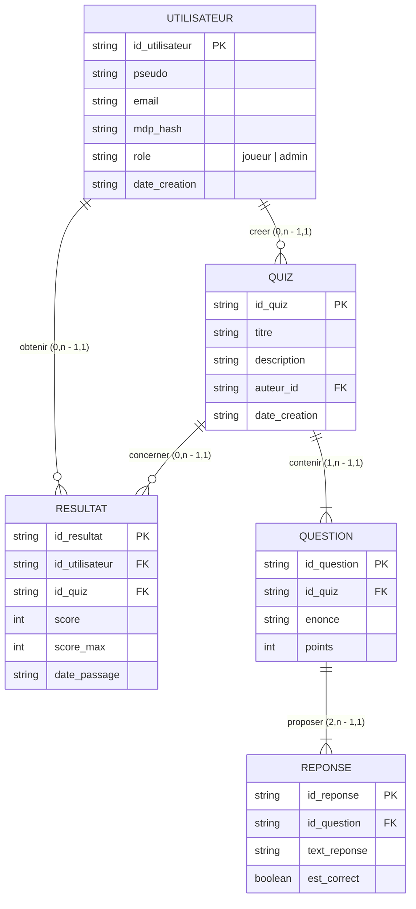

# Documentation du Modèle Conceptuel de Données (MCD)

Le modèle conceptuel de données modélise les entités et relations nécessaires au fonctionnement de l'application de quiz. Il a été conçu sous l'outil **Looping** (fichier source : [`docs/quiz.mdc`](file:///c:/Users/Admin/Desktop/PROJ531-Quiz-Python/docs/quiz.mdc)).

---

## 1. Schéma Entité-Association

---

## 2. Dictionnaire des données

| Entité | Attribut | Type | Contrainte | Description |
| :--- | :--- | :--- | :--- | :--- |
| **Utilisateur** | `id_utilisateur` | Chaîne (UUID) | Clé primaire | Identifiant unique généré pour l'utilisateur. |
| | `pseudo` | Chaîne (3-30 car.) | Unique, Non nul | Pseudonyme visible de l'utilisateur. |
| | `email` | Chaîne (format mail) | Unique, Non nul | Adresse e-mail de l'utilisateur. |
| | `mdp_hash` | Chaîne | Non nul | Empreinte sécurisée du mot de passe (Sel + SHA-256). |
| | `role` | Chaîne | "joueur" ou "admin" | Rôle définissant les autorisations dans l'application. |
| | `date_creation` | Chaîne ISO 8601 | Non nul | Date et heure de l'inscription. |
| **Quiz** | `id_quiz` | Chaîne (UUID) | Clé primaire | Identifiant unique du quiz. |
| | `titre` | Chaîne (1-100 car.) | Non nul | Titre descriptif du quiz. |
| | `description` | Chaîne | Optionnel | Description ou thème du quiz. |
| | `auteur_id` | Chaîne (UUID) | Clé étrangère | Identifiant de l'administrateur créateur. |
| | `date_creation` | Chaîne ISO 8601 | Non nul | Date de création du quiz. |
| **Question** | `id_question` | Chaîne (UUID) | Clé primaire | Identifiant unique de la question. |
| | `id_quiz` | Chaîne (UUID) | Clé étrangère | Quiz auquel est rattachée la question. |
| | `enonce` | Chaîne | Non nul | Texte de la question posée au joueur. |
| | `points` | Entier | >= 1 (défaut: 1) | Nombre de points attribués pour une bonne réponse. |
| **Reponse** | `id_reponse` | Chaîne (UUID) | Clé primaire | Identifiant unique de la proposition de réponse. |
| | `id_question` | Chaîne (UUID) | Clé étrangère | Question associée à cette réponse. |
| | `text_reponse` | Chaîne | Non nul | Texte de la réponse proposée. |
| | `est_correct` | Booléen | Non nul | Indique si la proposition est la bonne réponse (`True`/`False`). |
| **Résultat** | `id_resultat` | Chaîne (UUID) | Clé primaire | Identifiant unique de la tentative de quiz. |
| | `id_utilisateur` | Chaîne (UUID) | Clé étrangère | Joueur ayant réalisé le quiz. |
| | `id_quiz` | Chaîne (UUID) | Clé étrangère | Quiz concerné par le passage. |
| | `score` | Entier | >= 0 | Nombre de bonnes réponses ou points obtenus. |
| | `score_max` | Entier | >= 1 | Nombre total de questions ou points possibles. |
| | `date_passage` | Chaîne ISO 8601 | Non nul | Horodatage du passage du quiz. |

---

## 3. Justification des règles de gestion et ajustements techniques

1. **Sécurité des mots de passe (`mdp` $\rightarrow$ `mdp_hash`) :**
   - Dans le diagramme Looping d'origine, le champ était nommé `mdp`. Pour respecter les bonnes pratiques de sécurité (OWASP, RGPD), nous ne stockons aucun mot de passe en clair. Le champ est renommé `mdp_hash` et stocke un sel combiné à un condensat SHA-256 (`salt$hash`).
2. **Correction orthographique :**
   - Correction de l'attribut `est_corect` en `est_correct` pour respecter les normes de qualité du code.
3. **Cardinalités minimales de réponse :**
   - Une question possède au minimum deux propositions de réponses (`2,n`), dont au moins une réponse vraie (`est_correct = True`), permettant de formuler un QCM valide.
4. **Conservation de l'historique :**
   - La relation `obtenir (0,n)` et `concerner (0,n)` permet à un joueur de passer plusieurs fois le même quiz ou différents quiz, chaque tentative étant horodatée et conservée dans l'entité `Résultat`.
