# Rapport final de projet - Quizora

**Application de création et de passation de quiz en Python**

| | |
| :--- | :--- |
| **Module** | PROJ531 - Gestion de projet informatique |
| **Établissement** | Polytech Annecy-Chambéry, Université Savoie Mont Blanc |
| **Équipe** | Bilal Draoui (product owner), Sabrin Kaaouiche, Chadi Kharchoufa, Gabrien Vaz |
| **Période** | Du 13 octobre au 23 novembre 2026 : cinq séances de travail, quatre sprints, soutenance |
| **Dépôt GitHub** | https://github.com/KaSabrin/PROJ531-Quiz-Python |
| **Tableau Trello** | https://trello.com/b/zFAmvu0D/proj531-quiz-python |

## Résumé

Quizora est une application Python de création et de passation de QCM, réalisée par une équipe de quatre étudiants dans le cadre du module PROJ531. Un administrateur crée des quiz, directement ou à partir d'un fichier texte. Un joueur crée un compte, répond aux quiz, obtient son score avec la correction de ses erreurs et consulte l'historique de ses résultats. L'application propose deux interfaces, une console et une interface graphique Tkinter, qui utilisent les mêmes services. Les données sont enregistrées dans des fichiers JSON locaux et les mots de passe sont hachés avec un sel.

Le projet a été conduit selon une démarche agile inspirée de Scrum : un PBS et un WBS, quatre sprints planifiés dans un diagramme de Gantt, un suivi des tâches sur Trello, un compte rendu à chaque séance et un dépôt GitHub commun. Toutes les exigences minimales du sujet sont satisfaites et vérifiées par 39 tests automatisés. Les deux principaux enseignements sont un glissement d'environ deux semaines sur les finitions et une adoption tardive des branches et des Pull Requests.

**Mots-clés :** Python, Tkinter, JSON, Scrum, Git, tests unitaires.

## Glossaire

| Terme | Définition |
| :--- | :--- |
| **CLI / GUI** | Interface en ligne de commande (console) / interface graphique |
| **MCD** | Modèle conceptuel de données, au formalisme Entité-Association (Merise) |
| **PBS / WBS** | Product / Work Breakdown Structure : décomposition du produit à livrer / du travail à réaliser |
| **Product owner (PO)** | Membre qui priorise le backlog, valide les livrables et fait le lien avec le commanditaire |
| **Backlog** | Liste priorisée des fonctionnalités et des tâches restant à réaliser |
| **Sprint** | Période de travail courte qui livre une partie fonctionnelle de l'application |
| **User story (US)** | Fonctionnalité décrite du point de vue de l'utilisateur |
| **Pull Request (PR)** | Demande de fusion d'une branche dans la branche principale `main`, relue par un autre membre |
| **Hachage salé** | Transformation irréversible d'un mot de passe, combiné à une valeur aléatoire propre à chaque compte |

Un glossaire plus complet du domaine est disponible dans `docs/glossaire.md`.

## Introduction

Le module PROJ531 demande de mener en équipe de quatre un projet de développement en Python, en appliquant les méthodes de gestion de projet vues en cours. L'enseignant joue le rôle du commanditaire. Il fixe un cahier des charges volontairement succinct et évalue le projet pour 60 % sur la gestion de projet et pour 40 % sur le développement.

Notre équipe a choisi le nom **Quizora** pour l'application demandée : un logiciel qui permet de créer des quiz et d'y répondre, en conservant l'historique des scores de chaque joueur.

Ce rapport dresse le bilan du projet. Il suit les critères d'évaluation du sujet : les objectifs du projet (partie A), la gestion du projet (B), l'autonomie de l'équipe face aux difficultés (C), la réalisation technique (D) et le bilan final (E). Chaque partie renvoie aux livrables déposés dans le dossier `docs/` du dépôt. Les annexes indiquent comment installer et lancer l'application.

## A. Objectifs du projet

### A.1 Compréhension du sujet

Le sujet demande une application Python qui permet de créer des quiz, c'est-à-dire des séries de questions auxquelles des utilisateurs autorisés répondent. L'application doit afficher le score final et les bonnes réponses. Le tableau suivant présente notre lecture du cahier des charges.

*Tableau 1 - Exigences du sujet et interprétation de l'équipe*

| Type | Exigence du sujet | Interprétation de l'équipe |
| :--- | :--- | :--- |
| Minimum | Création de compte | Inscription et connexion, avec deux rôles : joueur et administrateur |
| Minimum | Historique des scores individuels | Chaque passage de quiz est enregistré et consultable par le joueur |
| Minimum | Création de quiz par un administrateur, directement ou depuis un fichier texte | Formulaire de création et import d'un fichier `.txt` au format défini par l'équipe |
| Minimum | Affichage du score final et des bonnes réponses | Correction après chaque question et récapitulatif des erreurs en fin de quiz |
| Option | Interface graphique | Réalisée avec Tkinter |
| Option | Minuterie, export JSON | Non réalisées (voir partie E) |

### A.2 Utilisateurs et fonctionnalités

L'analyse du sujet fait apparaître deux catégories d'utilisateurs. L'**administrateur** crée des quiz, manuellement ou par import d'un fichier texte, et consulte la liste des utilisateurs. Le **joueur** crée son compte, se connecte, répond aux quiz, voit son score et les bonnes réponses, puis consulte ses résultats personnels. Ces besoins ont été formulés en user stories dans le backlog Trello, par exemple :

*Tableau 2 - Principales user stories du backlog (formulations résumées)*

| User story | Formulation |
| :--- | :--- |
| US02 - Gestion des comptes | En tant que visiteur, je veux créer un compte et me connecter pour accéder à mon espace. |
| US04 - Création manuelle de quiz | En tant qu'administrateur, je veux saisir un quiz question par question. |
| US05 - Import de quiz | En tant qu'administrateur, je veux importer un quiz écrit dans un fichier texte. |
| US06 - Passation de quiz | En tant que joueur, je veux répondre à un quiz et connaître mon score et les bonnes réponses. |
| US07 - Historique des scores | En tant que joueur, je veux consulter mes résultats passés, avec ma moyenne et mon meilleur score. |
| US11 - Interface graphique | En tant qu'utilisateur, je veux utiliser l'application dans une fenêtre plutôt que dans un terminal. |

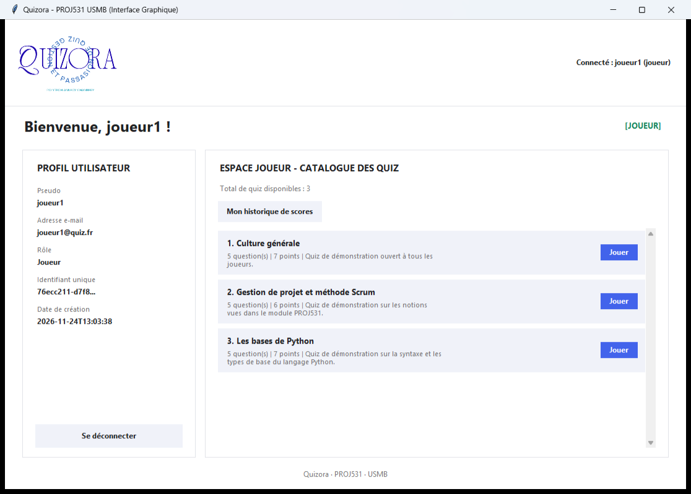
*Figure 1 - Espace joueur de l'interface graphique : profil, catalogue des quiz et accès à l'historique*

### A.3 Objectifs de gestion de projet

Le second objectif du projet est d'apprendre à mener le développement d'un logiciel de bout en bout. Le sujet impose pour cela un cadre précis :

- un **product owner** chargé du suivi du projet et du lien avec le commanditaire ;
- un **dépôt GitHub** dont chaque membre est collaborateur, avec une version sans bug disponible à la fin de chaque séance ;
- un **tableau Trello** pour définir, attribuer et suivre les tâches ;
- des **tâches de deux jours au plus**, selon la méthode Scrum ;
- un **compte rendu à chaque fin de séance**, avec le temps estimé et le temps réellement passé sur chaque tâche ;
- les livrables suivants : planning Gantt, PBS, WBS et planning des sprints, MCD, code source avec README, comptes rendus et présent rapport.

## B. Gestion du projet

### B.1 Organisation de l'équipe et rôles

L'équipe compte quatre membres. Bilal Draoui a été désigné product owner dès la première séance. Le tableau suivant présente les responsabilités de chacun, telles qu'elles figurent dans les comptes rendus et sur le tableau Trello.

*Tableau 3 - Rôles et responsabilités*

| Membre | Rôle | Principales responsabilités |
| :--- | :--- | :--- |
| Bilal Draoui | Product owner et développeur | Suivi du backlog, avancement du projet, validation des fonctionnalités, lien avec l'enseignant, README et comptes rendus ; contribution au développement |
| Sabrin Kaaouiche | Développeuse | MCD, comptes, interface console, création des quiz, scores et historique, amélioration de l'interface graphique |
| Chadi Kharchoufa | Développeur | Planification (WBS, Gantt), sécurité des mots de passe, import des quiz, tests |
| Gabrien Vaz | Développeur | Tableau Trello, stockage JSON, passage des quiz, tests |

Le rôle de Scrum Master a été partagé : Gabrien suivait le tableau Trello, Chadi le planning, et Sabrin la communication de l'équipe et le traitement des blocages. Les membres ont travaillé seuls ou en binôme selon les tâches. Les décisions importantes ont été prises ensemble, lors du point de fin de séance, et consignées dans le compte rendu. L'historique Git ne mesure pas à lui seul la contribution de chacun : la conception, la planification, la tenue du tableau Trello, les tests manuels et la relecture n'y apparaissent pas.

### B.2 Ressources du projet

- **Humaines :** quatre étudiants, pendant les séances encadrées et en travail personnel entre les séances.
- **Logicielles :** Python 3.10 ou plus récent, limité à la bibliothèque standard ; Visual Studio Code ; Git et GitHub ; Trello ; GanttProject ; Looping pour le MCD.
- **Matérielles :** les ordinateurs personnels des membres. Aucun serveur ni base de données n'est nécessaire, puisque les données sont stockées dans des fichiers JSON locaux.

### B.3 Modèle de processus

Nous avons suivi une démarche **agile inspirée de Scrum**, adaptée au rythme des séances :

- le **backlog** est tenu sur Trello sous forme de user stories découpées en tâches ;
- chaque **sprint** livre une partie fonctionnelle de l'application et correspond à une ou deux séances ;
- le **product owner** priorise les cartes en début de sprint et valide les tâches terminées ;
- le rôle de **Scrum Master** est partagé entre Gabrien (Trello), Chadi (planning) et Sabrin (communication et blocages) ;
- le **point de fin de séance** joue le rôle de revue de sprint : l'équipe fait le bilan, note les difficultés et décide des prochaines actions dans le compte rendu.

Nous n'avons pas pratiqué de mêlée quotidienne : les points d'équipe avaient lieu à chaque séance. Entre deux séances, le tableau Trello et l'historique du dépôt permettaient à chacun de voir l'avancement des autres.

### B.4 Décomposition du produit et du travail

Avant de planifier, l'équipe a décomposé le projet de deux manières complémentaires. Le **PBS** décompose le produit à livrer en trois branches : l'application Python, la documentation et les livrables de gestion de projet.

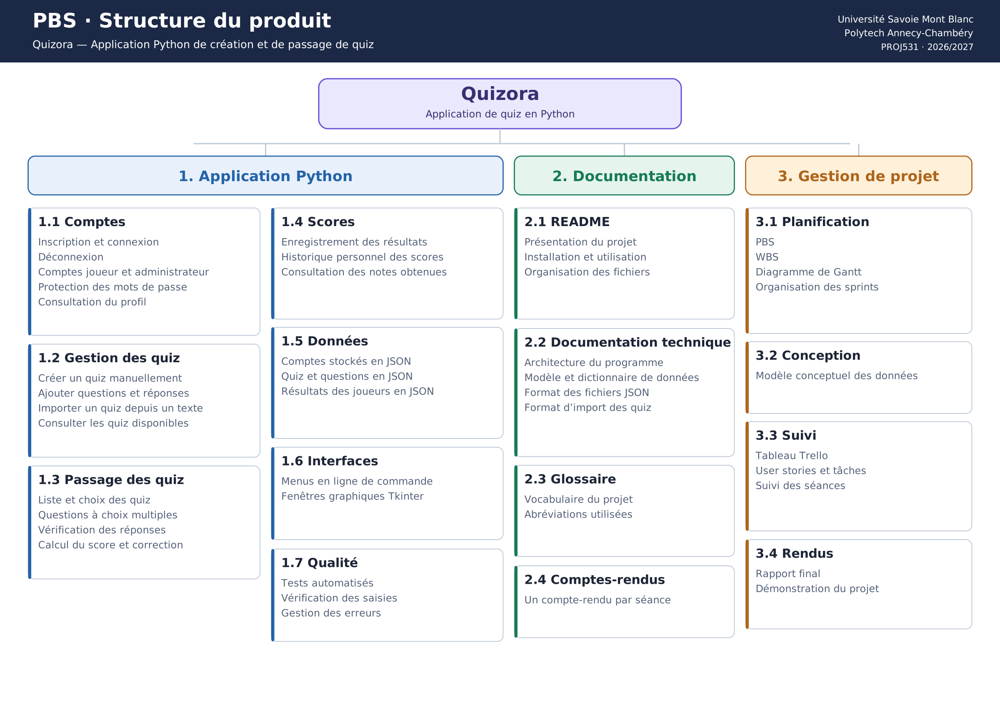
*Figure 2 - PBS : décomposition du produit à livrer (docs/PBS_Quizora.png)*

Le **WBS** décompose le travail nécessaire en six axes : cadrage et conception, comptes et données, gestion des quiz côté administrateur, passage de quiz et résultats, qualité et options, documentation et rendus. Chaque axe est ensuite découpé en tâches de deux jours au plus, qui deviennent les cartes du tableau Trello.

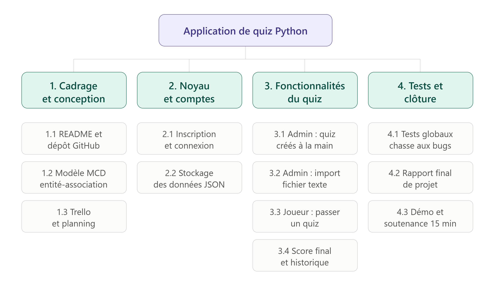
*Figure 3 - WBS : décomposition du travail en six axes (docs/wbs_projet_quiz_python.png)*

### B.5 Planification

Les tâches du WBS ont été réparties en quatre sprints successifs, planifiés dans un diagramme de Gantt.

*Tableau 4 - Planning des sprints*

| Sprint | Dates prévues | Contenu | Principaux livrables |
| :--- | :--- | :--- | :--- |
| 1 - Cadrage et conception | 12/10 - 15/10 | Dépôt GitHub, README, MCD, WBS, Gantt, Trello | MCD, WBS, Gantt, tableau Trello |
| 2 - Comptes et stockage | 19/10 - 22/10 | Architecture du code, comptes, hachage des mots de passe, stockage JSON, menu console | `src/models/`, `auth_service.py`, `security.py`, `storage_service.py`, 15 tests |
| 3 - Cœur du quiz | 26/10 - 30/10 | Création manuelle, import depuis un fichier texte, passation, première interface graphique | `quiz_service.py`, `import_service.py`, `gui.py` |
| 4 - Scores et finitions | 02/11 - 06/11 | Historique des scores, chasse aux bugs, interface graphique complète, rapport, soutenance | `resultat_service.py`, quiz de démonstration, rapport |

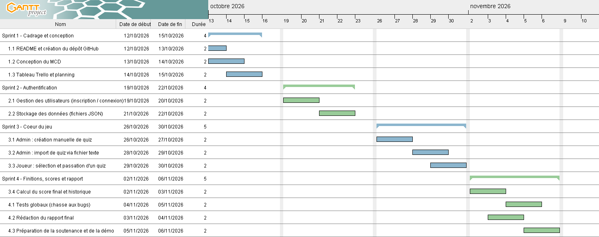
*Figure 4 - Diagramme de Gantt prévisionnel (docs/Gantt_projet_quiz.gan)*

### B.6 Suivi de l'avancement

Trois outils ont servi au suivi, chacun avec un rôle précis.

**Trello** organise le travail au quotidien. Le tableau comporte les colonnes Backlog, À faire (sprint actuel), En cours, À vérifier et Terminé. Chaque carte correspond à une user story ou à une tâche, avec ses responsables. Une capture du tableau est jointe à chaque compte rendu à partir du sprint 2 (`docs/trello_sprint2.png` à `trello_sprint5.png`).

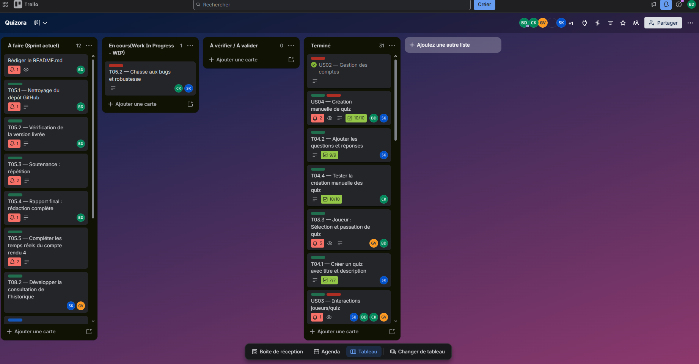
*Figure 5 - Tableau Trello de l'équipe lors de la séance 5*

**Les comptes rendus de séance** gardent la trace des décisions. Un compte rendu a été déposé sur GitHub à la fin de chacune des cinq séances (`docs/comptes-rendus/`). Pour chaque tâche, il indique le responsable, le temps estimé, le temps réellement passé et le statut, puis les difficultés et les prochaines étapes.

*Tableau 5 - Comptes rendus de séance*

| Séance | Date | Thème |
| :--- | :--- | :--- |
| 1 | 13/10 | Cadrage et conception initiale |
| 2 | 19/10 | Sprint 2 : authentification et stockage |
| 3 | 23/10 | Sprint 3 : création, import et passation de quiz |
| 4 | 02/11 | Sprint 4 : historique des scores, consolidation, préparation de la soutenance |
| 5 | 09/11 | Finalisation, rapport final, préparation de la soutenance |

La figure 6 compare, séance par séance, le temps estimé et le temps réel déclaré dans les comptes rendus. Sur l'ensemble du projet, **38 h 15 ont été estimées et 33 h 40 déclarées**, soit un écart de 12 %. Les estimations ont surtout été trop prudentes en séance 2, où la structure du code a été mise en place plus vite que prévu. Les temps réels des séances 4 et 5 ont été reconstitués après coup par l'équipe et sont marqués comme approximatifs dans les comptes rendus. Ces chiffres ne couvrent que les tâches suivies dans les comptes rendus, pas l'ensemble du travail personnel.

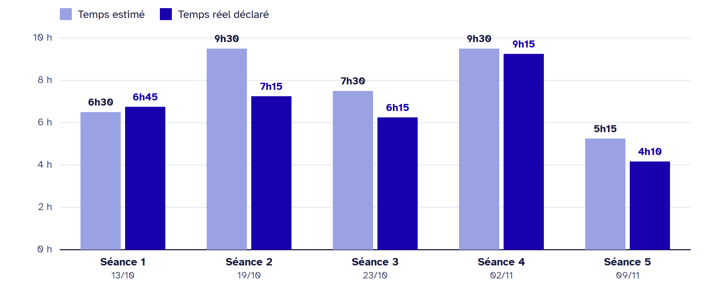
*Figure 6 - Temps estimé et temps réel déclaré par séance (source : comptes rendus 1 à 5)*

**GitHub** assure la traçabilité du code. Au 23 novembre 2026, jour de la soutenance, la branche `main` compte **99 commits**. À partir de la séance 5, chaque membre dispose de sa propre branche (`dev-bilal`, `dev-sabrine`, `dev-chadi`, `dev-gabrien`) et les modifications passent par des Pull Requests relues avant la fusion.

### B.7 Planning prévu et réalisé

La figure 7 confronte le Gantt aux commits effectivement enregistrés chaque jour dans le dépôt.

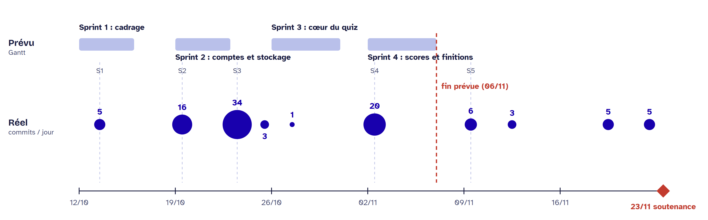
*Figure 7 - En haut, les sprints prévus au Gantt ; en bas, les commits enregistrés par jour (source : historique Git de main)*

Trois constats s'en dégagent :

- **Le sprint 3 a commencé plus tôt que prévu.** La séance 3 a eu lieu le 23 octobre, avant la date de début prévue du 26 octobre, et c'est la journée la plus productive du projet avec 34 commits.
- **Le sprint 4 a débordé.** La fin du projet était prévue le 6 novembre. Une séance 5 a été nécessaire le 9 novembre pour le rapport et la préparation de la soutenance, puis des corrections et des améliorations de l'interface graphique ont été intégrées jusqu'au 22 novembre.
- **Le travail est concentré sur les jours de séance.** Les pics d'activité correspondent aux séances, ce qui montre que l'équipe avançait surtout ensemble, en présence de l'enseignant.

Nous avons choisi de consigner ces écarts dans les comptes rendus plutôt que de modifier le Gantt après coup, afin de pouvoir comparer le prévu et le réalisé.

### B.8 Démarche d'amélioration continue

À chaque séance, l'équipe a fait le point sur l'avancement et a ajusté ses pratiques :

- **séance 2 :** le champ `mdp` prévu dans le MCD a été remplacé par `mdp_hash` pour ne jamais stocker de mot de passe en clair, et l'encodage UTF-8 a été imposé pour éviter les problèmes d'accents sous Windows ;
- **séance 3 :** les emojis ont été retirés de la console et de la documentation pour garantir un affichage correct sur tous les postes ;
- **séance 4 :** une relecture complète du code a permis de corriger sept anomalies et de supprimer du code inutilisé ;
- **séance 5 :** le retour d'expérience sur l'utilisation de Git a conduit à adopter des branches individuelles, des Pull Requests et des règles de travail écrites dans `CONTRIBUTING.md`.

Ce dernier changement a été appliqué jusqu'à la fin du projet. Ainsi, la Pull Request n°2 de Sabrin Kaaouiche a été relue par Bilal Draoui, et la Pull Request n°4 de Bilal Draoui par Chadi Kharchoufa, avant leur fusion.

## C. Autonomie de l'équipe et gestion des difficultés

### C.1 Auto-formation

Plusieurs notions ont été apprises en cours de projet, à partir de la documentation officielle de Python et de recherches personnelles :

- **Git et GitHub en équipe :** récupération du travail des autres, résolution de conflits, branches, Pull Requests, fichier `.gitignore` ;
- **sécurité :** hachage des mots de passe avec sel (`hashlib`, `secrets`) et comparaison en temps constant (`hmac`) ;
- **Tkinter**, pour réaliser l'interface graphique ;
- **tests unitaires** avec le module `unittest`, en travaillant dans des dossiers temporaires pour ne jamais modifier les vraies données ;
- **Markdown**, pour le README, les comptes rendus et ce rapport.

### C.2 Difficultés rencontrées et décisions prises

*Tableau 6 - Difficultés et décisions*

| Difficulté | Décision |
| :--- | :--- |
| **Périmètre du MCD** (séance 1) : fallait-il enregistrer chaque réponse du joueur ou seulement son score ? | Conformément au minimum demandé, l'entité Résultat est liée à Utilisateur et à Quiz, sans enregistrer chaque réponse. |
| **Découpage en tâches de deux jours** (séance 1) | Quatre sprints progressifs et des tâches courtes dans le WBS et le Gantt. |
| **Stockage des mots de passe** (séance 2) | Hachage SHA-256 avec un sel aléatoire de 16 octets propre à chaque compte. |
| **Conflit Git sur `src/cli.py`** (séance 4) : deux membres avaient modifié la même partie du menu joueur directement sur `main`. | Conflit résolu à la main. La relecture a aussi révélé une méthode appelée mais pas encore écrite, qui faisait planter l'option « historique » ; elle a été ajoutée. Décision durable : une branche par membre et des Pull Requests. |
| **Anomalies découvertes en fin de projet** (séance 4) : boucle sans fin à la création d'un quiz, plantage à l'import d'un fichier non texte, barème `[1 pt]` mal lu, tests d'import jamais exécutés | Corrections et un test de non-régression pour chaque anomalie. |
| **Robustesse des données** (12/11) : un même fichier importé deux fois créait un doublon, et un fichier JSON abîmé faisait perdre les comptes | Refus des titres de quiz en double ; copie de sauvegarde d'un fichier illisible avant sa réécriture. |
| **Quiz invalide bloquant la passation** (19/11) | Vérification avant le lancement d'un quiz, dans la console comme dans l'interface graphique (Pull Request n°2). |
| **Commits non rattachés aux comptes GitHub** | Ajout et vérification de l'adresse e-mail utilisée par Git dans les paramètres GitHub. |
| **Dépassement du planning** : fin prévue le 06/11 | Séance 5 consacrée à la finalisation ; écart consigné dans les comptes rendus. |

### C.3 Prise d'initiatives

Au-delà du minimum demandé, l'équipe a pris plusieurs initiatives :

- une **interface graphique complète**, qui offre les mêmes fonctions que la console ;
- trois **quiz de démonstration** importés automatiquement au premier lancement, pour tester l'application sans aucune saisie ;
- un **dossier d'architecture technique**, un **glossaire** et un **PBS**, en complément des livrables demandés ;
- des **règles de travail Git** écrites (`CONTRIBUTING.md`), avec des conventions de messages de commit.

### C.4 Communication et cohésion

La répartition des tâches par module (interfaces, services, modèles) a permis à chacun d'avancer sur sa partie en limitant les modifications simultanées des mêmes fichiers. Le product owner centralise les échanges avec l'enseignant. Les comptes rendus, rédigés à chaque séance, servent de référence commune pour savoir qui fait quoi. Enfin, la relecture croisée des Pull Requests a renforcé le partage des connaissances sur le code.

## D. Réalisation technique

### D.1 Architecture logicielle

L'application suit une **architecture en couches** qui sépare l'affichage, la logique métier et l'accès aux données. Le dossier d'architecture complet est disponible dans `docs/architecture_technique_quizora.pdf`.

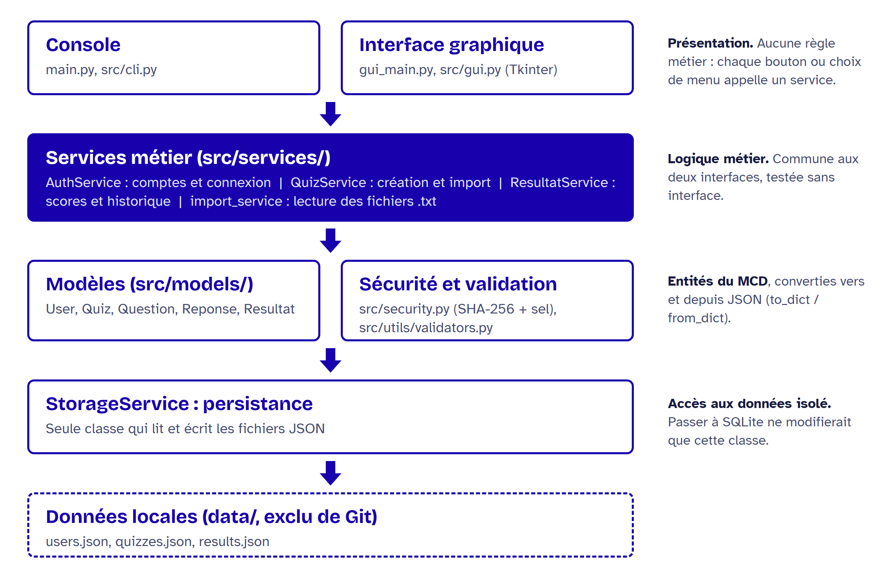
*Figure 8 - Architecture en couches : deux interfaces, une seule logique métier*

*Tableau 7 - Couches et fichiers*

| Couche | Fichiers | Rôle |
| :--- | :--- | :--- |
| Présentation | `main.py`, `gui_main.py`, `src/cli.py`, `src/gui.py` | Interface console ou fenêtre Tkinter ; aucune règle métier |
| Services | `auth_service.py`, `quiz_service.py`, `import_service.py`, `resultat_service.py` | Inscription et connexion, création et import de quiz, scores et historique |
| Modèles | `src/models/` : `User`, `Quiz`, `Question`, `Reponse`, `Resultat` | Entités du MCD, avec conversion vers et depuis JSON |
| Sécurité et validation | `src/security.py`, `src/utils/validators.py` | Hachage des mots de passe, contrôle des pseudos, e-mails et mots de passe |
| Persistance | `storage_service.py`, dossier `data/` | Lecture et écriture des fichiers JSON |

Ce découpage a un bénéfice concret : l'interface graphique a été ajoutée, puis refaite, **sans modifier la logique métier**, et cette logique est testée indépendamment de toute interface. De même, remplacer les fichiers JSON par une base de données ne toucherait que `StorageService`. Le code applicatif compte environ 2 850 lignes, et les tests environ 600 lignes.

### D.2 Modèle de données

Le MCD a été conçu sous Looping dès la première séance, avant le développement. Il comporte cinq entités. Un utilisateur crée des quiz et obtient des résultats ; un quiz contient au moins une question ; une question propose au moins deux réponses ; un résultat concerne un utilisateur et un quiz. Le dictionnaire des données est dans `docs/mcd_documentation.md`.

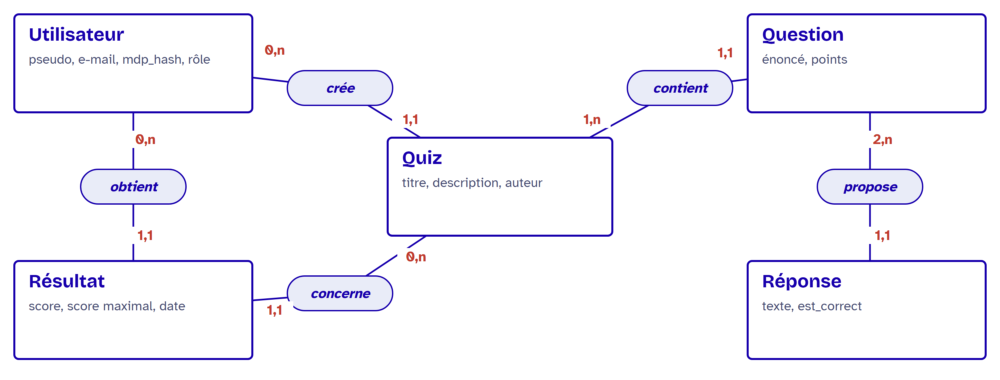
*Figure 9 - Modèle conceptuel de données, redessiné à partir du MCD Looping (docs/mcd_quizora.png)*

Chaque entité est devenue une classe Python du dossier `src/models/`, dotée de méthodes `to_dict` et `from_dict` pour l'enregistrement en JSON. Une règle métier complète le modèle : chaque question doit avoir **au moins deux propositions et exactement une bonne réponse**. Elle est vérifiée à la création, à l'import et avant le lancement d'un quiz.

### D.3 Fonctionnalités et interfaces

Les deux interfaces offrent les mêmes fonctions.

- **Administrateur :** créer un quiz question par question, importer un quiz depuis un fichier `.txt`, consulter la liste des utilisateurs.
- **Joueur :** créer un compte, choisir un quiz dans le catalogue, répondre aux questions avec une correction immédiate, obtenir le score final et le récapitulatif des erreurs, consulter l'historique avec la moyenne et le meilleur score.

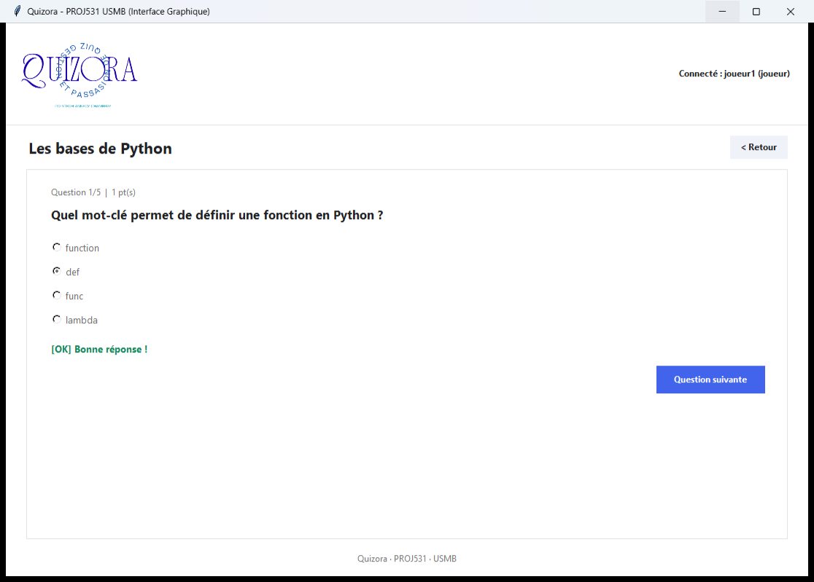
*Figure 10 - Passation d'un quiz : la réponse est corrigée dès sa validation*

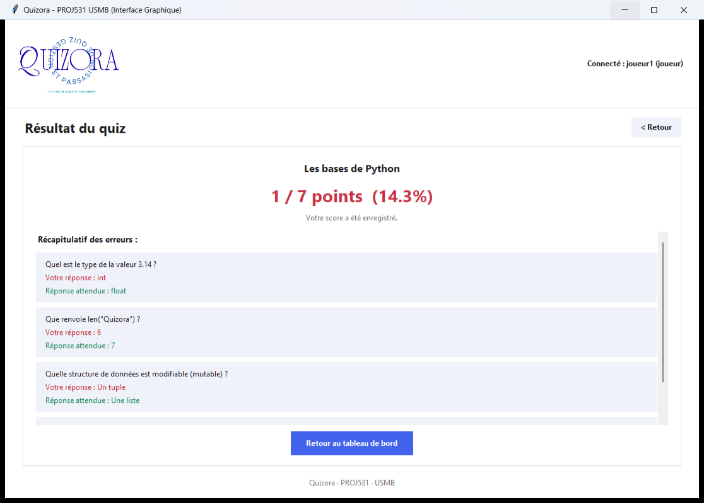
*Figure 11 - Fin de quiz : score, pourcentage et récapitulatif des erreurs avec la réponse attendue*

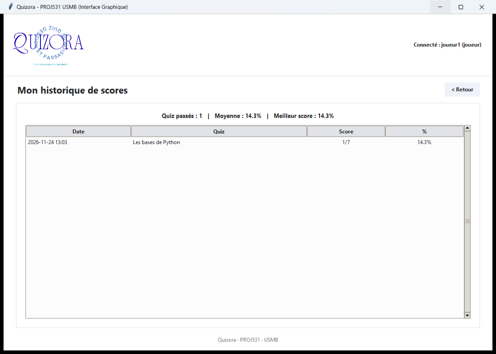
*Figure 12 - Historique des scores du joueur, avec la moyenne et le meilleur score*

La console affiche les mêmes informations sous forme de texte, par exemple pour l'historique :

```text
HISTORIQUE DES SCORES DE JOUEUR1
======================================================================
Date               Quiz                               Score        %
----------------------------------------------------------------------
2026-11-02 17:40   Culture Informatique et Génie…       4/4   100.0%
2026-11-02 17:40   Culture Informatique et Génie…       3/4    75.0%
----------------------------------------------------------------------
Quiz passés : 2 | Moyenne : 87.5% | Meilleur score : 100.0%
```

### D.4 Import de quiz depuis un fichier texte

Nous avons défini un format de fichier simple, qu'un enseignant peut écrire dans n'importe quel éditeur de texte :

```text
TITRE: Culture Informatique et Génie Logiciel
DESCRIPTION: Quiz d'exemple pour tester l'importation.

QUESTION: Quel langage de programmation a été créé par Guido van Rossum ? [2 pts]
- Java
- C++
* Python
- Ruby
```

Le parseur lit le fichier ligne par ligne. Une expression régulière extrait le barème entre crochets (un point par défaut), l'étoile marque la bonne réponse et le tiret les autres propositions. Le quiz obtenu passe ensuite par les mêmes vérifications que la création manuelle. Un fichier introuvable, un dossier, un fichier non texte (PDF, image) ou un titre déjà présent est refusé avec un message clair, sans arrêter l'application. Les fichiers enregistrés en « UTF-8 avec BOM » par le Bloc-notes de Windows sont acceptés.

### D.5 Sécurité

- **Mots de passe :** chaque mot de passe est combiné à un sel aléatoire de 16 octets (module `secrets`), puis haché avec SHA-256. Seuls le sel et l'empreinte sont enregistrés. La vérification compare les empreintes en temps constant (`hmac.compare_digest`).
- **Validation des saisies :** pseudo de 3 à 30 caractères, adresse e-mail au format valide, mot de passe d'au moins 6 caractères avec au moins une lettre et un chiffre.
- **Données :** le dossier `data/` est exclu du dépôt par `.gitignore`, ce qui évite de publier les comptes des utilisateurs.

Ces mesures conviennent à un projet pédagogique. Les limites sont discutées dans la partie E.

### D.6 Choix techniques et alternatives

*Tableau 8 - Choix techniques justifiés*

| Choix | Alternatives étudiées | Justification |
| :--- | :--- | :--- |
| **Python, programmation orientée objet** | (langage imposé) | Une classe par entité du MCD ; code modulaire et testable |
| **Fichiers JSON** | SQLite, fichiers CSV | Lisible, natif en Python, sans serveur ; adapté à une application locale. Limite : un seul utilisateur à la fois |
| **Bibliothèque standard uniquement** | Bibliothèques externes d'interface ou de sécurité | Installation immédiate par un simple `git clone`, aucun problème de version entre les postes |
| **Tkinter** | Application web (HTML, CSS, JavaScript) | Inclus dans Python ; application de bureau sans serveur web |
| **SHA-256 avec sel** | Stockage en clair, hachage sans sel | Aucun mot de passe en clair ; le sel empêche l'usage de tables précalculées |
| **Import au format texte** | JSON, CSV | Format lisible et facile à écrire à la main |
| **`unittest`** | `pytest` | Inclus dans Python, donc aucune dépendance à installer |

### D.7 Validation et qualité

La validation repose sur **39 tests unitaires automatisés**, lancés avec la commande `python -m unittest discover tests` avant chaque envoi sur GitHub. Les tests travaillent dans des dossiers temporaires et ne modifient jamais les données réelles.

*Tableau 9 - Répartition des tests*

| Fichier | Tests | Ce qui est vérifié |
| :--- | :---: | :--- |
| `test_auth.py` | 10 | Inscription valide, refus des doublons, des e-mails invalides et des mots de passe faibles, connexion, déconnexion |
| `test_quiz.py` | 7 | Création par un administrateur, refus pour un joueur, import, refus des titres en double, quiz de démonstration |
| `test_resultat.py` | 6 | Enregistrement des scores, refus des scores incohérents, historique propre à chaque joueur, statistiques |
| `test_import.py` | 5 | Lecture du format texte, barème `[1 pt]`, fichier introuvable, fichier non texte, fichier avec BOM |
| `test_security.py` | 4 | Format du hachage, unicité grâce au sel, vérification réussie ou refusée |
| `test_storage.py` | 3 | Création des fichiers, sauvegarde et rechargement, fichier JSON abîmé |
| `test_cli.py`, `test_gui.py` | 4 | Contrôle d'un quiz avant son lancement (quiz valide, vide ou mal formé), dans la console et dans l'interface graphique |

La suite de tests a grandi avec le projet : 15 tests à la fin du sprint 2, 28 après la chasse aux bugs de la séance 4, 30 avec les quiz de démonstration, 35 après la revue de robustesse du 12 novembre, et 39 avec la Pull Request n°2. Plusieurs de ces tests sont nés d'un bug : le test qui reproduit le problème est écrit avec la correction, pour qu'il ne puisse pas réapparaître.

Des parcours complets ont également été vérifiés manuellement, en console et dans l'interface graphique : connexion de l'administrateur, import d'un quiz, connexion d'un joueur, passation d'un quiz et consultation de l'historique.

## E. Bilan final

### E.1 Résultats obtenus

*Tableau 10 - Exigences du cahier des charges et résultats*

| Exigence | Résultat |
| :--- | :--- |
| Création de compte | Réalisé : inscription, connexion, rôles joueur et administrateur, mots de passe hachés |
| Historique des scores individuels | Réalisé : enregistrement automatique, historique avec moyenne et meilleur score |
| Création de quiz par l'administrateur, directement | Réalisé, en console et dans l'interface graphique |
| Création de quiz depuis un fichier texte | Réalisé, en console et dans l'interface graphique |
| Affichage du score final et des bonnes réponses | Réalisé |
| Interface graphique (option) | Réalisée |
| Minuterie, export JSON (options) | Non réalisés |

Côté gestion de projet, tous les livrables demandés sont présents dans le dépôt : PBS, WBS, Gantt, planning des sprints, MCD, README, comptes rendus des cinq séances et présent rapport.

*Tableau 11 - Indicateurs du projet*

| Indicateur | Valeur |
| :--- | :--- |
| Durée | 13 octobre - 23 novembre 2026 : 5 séances de travail, 4 sprints |
| Commits sur `main` | 99 (au 23/11/2026) |
| Pull Requests fusionnées | 3 (n°2, 3 et 4) |
| Tests automatisés | 39, tous réussis |
| Taille du code | environ 2 850 lignes d'application, 600 lignes de tests |
| Temps des tâches suivies | 38 h 15 estimées, 33 h 40 déclarées |

### E.2 Évaluation critique

- **Utilisation de Git :** pendant la plus grande partie du projet, l'équipe a travaillé directement sur la branche `main`, sans relecture. C'est à l'origine du conflit et du plantage de la séance 4. Les branches et les Pull Requests n'ont été adoptées qu'en fin de projet, et certains messages de commit (« Update cli.py ») ne décrivent pas le changement effectué.
- **Planning :** la fin du sprint 4 cumulait trop de travaux (historique, corrections, interface graphique, rapport). Le projet s'est terminé environ deux semaines après la date prévue, et le Gantt ne comporte pas de marge.
- **Suivi des temps :** les temps réels des séances 4 et 5 ont été reconstitués après coup ; ils auraient dû être notés au fil de l'eau.
- **Tests :** la logique métier est bien couverte, mais l'interface graphique n'est vérifiée que par quatre tests et par des essais manuels.
- **Sécurité :** un seul passage de SHA-256 est rapide à calculer, donc plus vulnérable à une attaque par force brute qu'un algorithme volontairement lent comme PBKDF2 ou bcrypt. Les comptes de démonstration sont créés avec des mots de passe connus, ce qui est acceptable pour une démonstration mais pas en production.
- **Stockage :** les fichiers JSON ne supportent pas l'accès simultané de plusieurs utilisateurs.
- **Points forts :** une architecture modulaire qui a permis d'ajouter et de refaire l'interface graphique sans toucher à la logique métier, une application installable sans aucune dépendance, une documentation complète et une suite de tests qui a grandi à chaque correction.

### E.3 Compétences acquises

Ce projet nous a permis de progresser sur le plan technique, avec la programmation orientée objet en Python, Tkinter, la sécurité des mots de passe et les tests automatisés. Il nous a surtout appris à planifier et à estimer un travail, à collaborer sur un même code avec Git, et à documenter nos décisions pour les retrouver et les expliquer.

### E.4 Pistes d'amélioration et perspectives

- **Organisation :** une branche par user story et une Pull Request relue dès la première séance ; des messages de commit normalisés ; une marge dans le planning pour les livrables de fin de projet ; un relevé des temps à la fin de chaque tâche.
- **Qualité :** exécution automatique des tests à chaque envoi sur GitHub (GitHub Actions) ; davantage de tests de l'interface graphique.
- **Technique :** passage à SQLite pour permettre plusieurs utilisateurs simultanés ; hachage des mots de passe avec PBKDF2 ou bcrypt.
- **Fonctionnalités :** minuterie par question ou par quiz ; export et import de quiz au format JSON ; modification et suppression de quiz par l'administrateur ; statistiques par quiz pour l'administrateur.

### E.5 Documentation réalisée

*Tableau 12 - Documents du projet*

| Document | Emplacement |
| :--- | :--- |
| README : objectif, installation, utilisation | `README.md` |
| Règles de travail Git | `CONTRIBUTING.md` |
| Comptes rendus des cinq séances | `docs/comptes-rendus/` |
| PBS, WBS, Gantt | `docs/PBS_Quizora.png`, `docs/wbs_projet_quiz_python.png`, `docs/Gantt_projet_quiz.gan` |
| MCD et dictionnaire des données | `docs/mcd_quizora.png`, `docs/mcd_documentation.md` |
| Dossier d'architecture technique | `docs/architecture_technique_quizora.pdf` |
| Glossaire | `docs/glossaire.md` |
| Captures du tableau Trello | `docs/trello_sprint2.png` à `docs/trello_sprint5.png` |
| Scénario de la démonstration | `docs/scenario_demonstration.md` |
| Rapport final | `docs/rapport_final.md` et `docs/rapport_final.pdf` |

## Conclusion

Le projet Quizora a abouti à une application complète, qui satisfait toutes les exigences minimales du sujet et y ajoute une interface graphique, le tout vérifié par 39 tests automatisés. Sur le plan de la gestion de projet, la décomposition en PBS et WBS, les sprints planifiés dans le Gantt, le suivi sur Trello et un compte rendu à chaque séance ont permis de livrer régulièrement des versions fonctionnelles et de garder la trace de nos décisions.

Les écarts que nous avons relevés sont autant d'enseignements : un planning sans marge a repoussé la fin du projet de deux semaines, et un travail direct sur la branche principale a provoqué un conflit que des branches et des Pull Requests auraient évité. Nous avons corrigé ce second point avant la fin du projet. Dans nos prochains projets, nous appliquerons ces pratiques dès le départ : des branches relues, des tests automatisés à chaque envoi et une marge dans le planning.

## Annexes

### Annexe A - Installation et lancement

L'application ne nécessite que Python 3.10 ou plus récent, sans aucune bibliothèque à installer.

```bash
git clone https://github.com/KaSabrin/PROJ531-Quiz-Python.git
cd PROJ531-Quiz-Python
python gui_main.py                   # interface graphique
python main.py                       # interface console
python -m unittest discover tests    # 39 tests
```

Au premier lancement, le dossier `data/` est créé avec deux comptes de démonstration et trois quiz d'exemple.

*Tableau 13 - Comptes de démonstration*

| Profil | Identifiant | Mot de passe |
| :--- | :--- | :--- |
| Administrateur | `admin` | `Admin123!` |
| Joueur | `joueur1` | `Joueur123!` |

### Annexe B - Organisation du dépôt

```text
PROJ531-Quiz-Python/
├── main.py, gui_main.py      points d'entrée (console, interface graphique)
├── sample_quiz.txt           exemple de fichier à importer
├── exemples/                 trois quiz de démonstration
├── src/
│   ├── cli.py, gui.py        interfaces
│   ├── security.py           hachage des mots de passe
│   ├── models/               User, Quiz, Question, Reponse, Resultat
│   ├── services/             auth, quiz, import, resultat, storage
│   └── utils/validators.py   validation des saisies
├── tests/                    39 tests unitaires
└── docs/                     livrables, comptes rendus, rapport
```

### Annexe C - Références

- Sujet du projet : `PROJ531_TP1TD2-6_GP_Projet_2026.pdf`, à la racine du dépôt.
- Documentation officielle de Python : modules `tkinter`, `unittest`, `hashlib`, `hmac`, `secrets` et `json` (https://docs.python.org/3/library/).
- Documentation de Git et de GitHub : https://git-scm.com/doc et https://docs.github.com.
